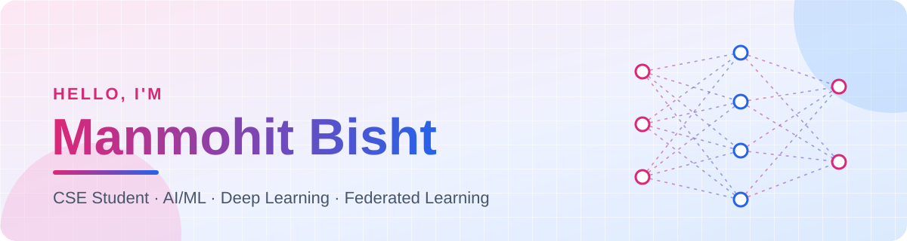

 <div align="center">



<a href="https://github.com/manmohit-bisht">

</a>

<br/>

<a href="https://www.linkedin.com/in/manmohit-bisht/">

</a>
<a href="mailto:manmohit.454@gmail.com">

</a>

</div>


## 👋 About Me

```python
class Manmohit:
    role       = "CSE Student"
    exploring  = ["AI/ML", "Deep Learning", "Federated Learning"]
    also_into  = ["Data Structures & Algorithms"]
    tech_stack = ["Python", "C++", "PyTorch", "scikit-learn"]
    tools      = ["Git", "GitHub", "Linux", "VS Code"]

    def say_hi(self):
        return "Always happy to connect and talk AI/ML!"
```

## 🎯 Focus Areas

| | Area | What draws me in |
|:-:|:--|:--|
| 🤖 | **AI / ML** | Building models that learn from data |
| 🧠 | **Deep Learning** | Neural networks and how they are trained |
| 🌐 | **Federated Learning** | Training models across decentralized data |
| 🧩 | **DSA** | Writing efficient, well-structured solutions |

## 🛠️ Tech Stack

<div align="center">

      


</div>


## 📊 GitHub Stats

<div align="center">


</div>

<br/><br/>

## 🌌 Contribution Universe
``` python
if (contribution >= 5): #🚀 Spacecraft fires a bullet whenever daily contributions reach 5 or more.
    space_craft.shoot()
```
<div align="center">

<a href="https://github.com/manmohit-bisht">

</a>

</div>


